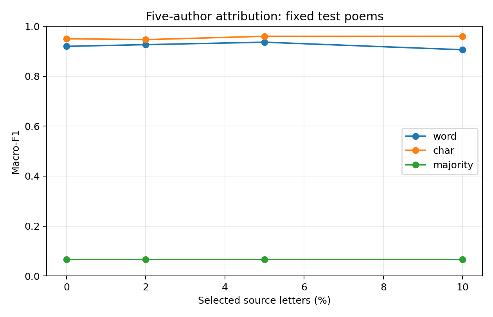
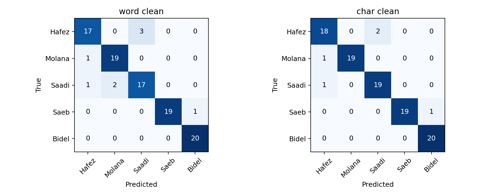

# Persian Poetry Attribution under Synthetic Text Corruption

A compact, reproducible CPU study of full-poem attribution for Hafez, Molana, Saadi, Saeb and Bidel. Research question: how do word and character TF-IDF models differ in clean accuracy and robustness to controlled insertions, deletions and substitutions?

**Status:** completed text experiment, v0.2. Retrieval, OCR and ASR are future work. This is a portfolio study and an adaptation of established methods; no new state-of-the-art or paper-level novelty claim.

## Main result

At 5% selected source-letter corruption, word macro-F1 averaged 0.9363 and character macro-F1 averaged 0.9601 across three fixed corruption seeds. Clean scores were 0.9197 and 0.9502, respectively.

Primary paired DeltaDrop (word loss minus character loss): **-0.0067**, 95% stratified percentile bootstrap CI **[-0.0434, 0.0249]**, 2,000 replicates. The interval includes zero; this study does not establish a reliable difference in F1 loss.

## Data and leakage controls

Pinned source: [Ganjoor data](https://github.com/ganjoor/ganjoor-data/tree/86455ef602c55f64282ce9a0fba4b1084153b5a7), revision `86455ef602c55f64282ce9a0fba4b1084153b5a7`. Downloaded 550 candidate files (7,485,064 bytes) for bounded local research. Only ordered Verses.Text enters the models; summaries, titles, author paths and other metadata are excluded.

Exactly 100 retained poems per author: 60 train / 20 validation / 20 test. Total 300 / 100 / 100. Split units are whole poems, one representative per retained duplicate component, with deterministic SHA-256 selection and split priorities. Previously inspected 100 audit poems and all components linked to them are excluded. Duplicate edges: 0; eligibility rejection counts (a file can have multiple reasons): `{'couplet_structure': 2, 'not_one_whole_ghazal': 5}`.

The exact duplicate graph uses normalized identity, character 5-gram set Jaccard >=0.80, and at least two distinct shared normalized couplets of >=6 words. Components with mixed author labels are excluded. These checks do not prove absence of all partial quotation, collection or editorial dependence. Arabic-script filtering is not language certification.

**Scope change before fitting:** v0.1 planned 1,000 poems; v0.2 reduced this to 500 following the user's request for faster compact completion. No model or validation/test performance had been inspected when this change was made. Original plans remain archived.

## Models and preprocessing

Eight LinearSVC(C=1) classifiers cross word (1,2) vs character (3,5) TF-IDF, minimal vs canonical normalization, and a shared author-alias mask on/off. A majority classifier is the ninth study model. Vocabulary and IDF are fitted only on training data; no validation refit or hyperparameter search.

Canonical normalization maps Arabic variants of ya/kaf, strips specified diacritics and tatweel, replaces ZWNJ with space, collapses whitespace and preserves punctuation. Masking scans original Unicode letter/mark runs and replaces any exact canonical alias from the same eight-name list for every class with MASKEDAUTHOR. This is an incomplete shortcut sensitivity control, not proof of stylistic purity; alias position/count and editorial conventions can remain useful cues.

The predeclared primary pair is canonical + shared masking. Other six conditions are clean-only secondary analyses. TF-IDF has min_df=2, float max_df=1.0, max_features=50,000, sublinear TF and L2 normalization. Equal caps do not imply equal model capacity. CPU threads=1.

## Clean results

| Model | Validation macro-F1 | Test macro-F1 | Test accuracy | Features |
|---|---:|---:|---:|---:|
| word__minimal__unmasked | 0.9699 | 0.9799 | 0.9800 | 6769 |
| word__minimal__masked | 0.9699 | 0.9594 | 0.9600 | 6757 |
| word__canonical__unmasked | 0.9700 | 0.9800 | 0.9800 | 6558 |
| word__canonical__masked | 0.9492 | 0.9197 | 0.9200 | 6547 |
| char__minimal__unmasked | 0.9700 | 0.9702 | 0.9700 | 50000 |
| char__minimal__masked | 0.9500 | 0.9602 | 0.9600 | 50000 |
| char__canonical__unmasked | 0.9699 | 0.9900 | 0.9900 | 46098 |
| char__canonical__masked | 0.9394 | 0.9502 | 0.9500 | 46147 |
| majority | 0.0667 | 0.0667 | 0.2000 | 0 |

## Synthetic robustness

Only the primary pair and majority are evaluated with corruption; models train on clean data. Each poem/seed has a stable position permutation and operation draws, so severity prefixes are nested. The shared ASCII mask token, whitespace and punctuation are protected. All models receive identical corrupted queries.

| Selected letters (%) | Word mean macro-F1 | Character mean macro-F1 | Majority mean macro-F1 |
|---:|---:|---:|---:|
| 2 | 0.9265 | 0.9466 | 0.0667 |
| 5 | 0.9363 | 0.9601 | 0.0667 |
| 10 | 0.9061 | 0.9601 | 0.0667 |

Rates select original letters from a fixed 33-letter alphabet; edits are uniform insertion/deletion/substitution. Selected-letter percentage is different from measured CER. Actual character/token Levenshtein counts, CER/WER, per-author metrics, confusion matrices and all predictions are recorded for every corruption seed. This is synthetic stress testing, **not real OCR/ASR performance**.

## Post-hoc diagnostic: why noise scores increased

At 5% corruption both mean F1 scores exceeded their clean scores on these 100 test poems. Across the 300 paired poem/seed predictions, the word model corrected 7 initially wrong predictions and broke 2 correct ones; the character model corrected 4 and broke 1. These are repeated predictions of the same poems, not 300 independent samples. The diagnostic was added after final evaluation, does not change the primary analysis, and does not show that noise improves generalization. Measured CER was about 3.81%, with WER about 15.4–15.5%, despite the nominal 5% selected-letter setting.

## Uncertainty and limits

The 95% interval resamples test poems within each author using the same indices across paired models and seeds. It conditions on these fitted models and this fixed split. It does not quantify training-seed or unseen-author uncertainty. Only 20 test poems per author makes estimates imprecise. Three corruption draws per poem are not independent test datasets. Full-poem closed-set accuracy does not measure attribution of individual couplets, unknown-author detection, indexed retrieval or plagiarism.

Models may exploit source/editorial and period differences. A low clean score can mechanically show a smaller drop, so inspect clean and noisy scores together. No direct benchmark comparison to larger corpora such as [PARSI](https://arxiv.org/abs/2506.21840) is claimed.

## Reproduction

Python 3.11.4, numpy 1.26.4, scikit-learn 1.9.0, scipy 1.17.1. No packages were installed for this run. Exact parameters, source/environment fingerprints, selected IDs and file SHA-256 hashes are included. Raw data and trained vocabulary/weights are kept local.

1. Place the code and JSON protocol files together in a working directory. Obtain candidate files from the pinned public source using the paths in candidate_selection_v02.jsonl; verify corpus_manifest.json hashes. Put new files in corpus/ and the separate 100 audit files in raw/ using acquisition.json paths and hashes.
2. Optionally use `python -B fetch_data.py` for hash-checked acquisition (not used in this run; this session used the connected GitHub tool). Run `python -B test_poetry.py`.
3. In a **fresh working directory**, run `python -B prepare_data.py`, then `python -B run_models.py`.
4. Review validation and run `python -B verify_before_test.py` to record fingerprints and the fixed primary analysis in FINAL_EVALUATION_PLAN.json; then run `python -B final_evaluate.py` once. Exclusive markers intentionally prevent silently overwriting a completed fit/evaluation.
5. Run `python -B make_report.py`.

Exact acquisition and evaluation receipts are bundled; no synthetic scores or fabricated training runs are used. The optional demo.py requires the local models directory and accepts full-poem text; confidence scores are not calibrated probabilities.

## Data use and attribution

[Ganjoor-associated notice](https://github.com/ganjoor/persian-poetry-ai-agent-plugin/blob/main/NOTICE.md) distinguishes poem text, editorial/compiled material and software. This project does not claim corpus redistribution clearance. The review bundle excludes raw and normalized poems, model weights, and vocabularies; do not publish the local cache as a repository.

No Git repository, commit, push or publication was performed.
