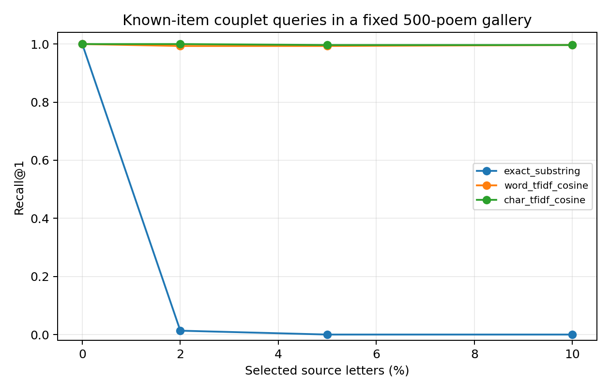

# Persian Poetry Attribution and Search

A CPU research project comparing full-poem author attribution with known-item poetry retrieval, followed by a small local OCR/ASR integration pilot.

The two text tasks are evaluated separately. Classifying an unseen poem among five known authors differs from finding a poem already present in a search gallery.

## Full-poem author attribution

Five authors: Hafez, Molana, Saadi, Saeb and Bidel. The fixed dataset has 500 poems, split into 300 training, 100 validation and 100 test poems. Previously inspected audit poems and duplicate-linked components were excluded. Models use only verse text, without titles or author metadata.

Eight LinearSVC conditions compare word/character TF-IDF, normalization and shared author-name masking. A majority classifier is the ninth baseline. Vocabulary and IDF are fitted only on training data.

| Primary model: canonical text + shared name masking | Clean test macro-F1 | Mean macro-F1 at 5% synthetic corruption |
|---|---:|---:|
| Word TF-IDF | 0.9197 | 0.9363 |
| Character TF-IDF | 0.9502 | 0.9601 |

The paired difference in F1 loss was -0.0067, with a 95% bootstrap interval [-0.0434, 0.0249]. No reliable difference in corruption-related F1 loss was established. Slightly higher noisy scores on this small test set do not show that adding noise improves generalization.

## Known-item retrieval

The gallery contains all 500 retained poems; gallery-wide IDF is intentional for this separate search task. One deterministically selected source couplet creates each query. On 100 final query poems, clean Recall@1 was 1.000 for exact substring, word cosine and character cosine search.

At 5% synthetic query corruption, mean Recall@1 was 0.9933 for word features and 0.9967 for character features. The paired interval for their difference included zero. Clean matching is an easy known-item check, not evidence of semantic understanding or unseen-poem attribution.

## Actual OCR and speech pilot

| Input condition | Samples | Pooled CER | Pooled WER | Known-item Recall@1 |
|---|---:|---:|---:|---:|
| Clean rendered text images | 20 | 0.4214 | 0.4305 | 0.8000 |
| Transformed versions of the same images | 20 | 0.1814 | 0.2152 | 1.0000 |
| Upstream-aligned real recitation clips | 3 | 0.2282 | 0.4808 | 1.0000 |

OCR used Tesseract/tesserocr with Persian language data. Speech used the small Persian Vosk model. These are exploratory engineering results: rendered images are not natural photos or handwriting, and the three clip references were not independently human-listened. Better transformed-image scores do not establish that blur helps OCR. Retrieval success despite high WER does not mean accurate transcription.

## Evidence and implementation

- [Frozen classification report](CLASSIFICATION_REPORT_v02.md)
- [Actual media report and limitations](MEDIA_REPORT.md)
- [Fixed classification configuration](text_experiment_v02.json)
- [Separate retrieval protocol](retrieval_protocol_v01.json)
- [Media pilot protocol](MEDIA_PROTOCOL_v01.json)

The original project passed 35 distinct behavior/integration tests. A fresh-folder rebuild in the same installed Python environment matched all 36 final classification prediction/metric records and bootstrap outputs exactly. Fresh-machine setup was not tested.

The local Persian demo accepts text, images and short audio. It keeps gallery matches separate from the five-author classifier, and returns no author guess for empty recognition. It is not a hosted public service. Raw poems, recordings, query text, fitted vocabularies, weights and native runtimes are excluded from this publication snapshot.

## References and rights

Ganjoor and the upstream OCR/speech components retain their own terms and attribution.

**All rights reserved — portfolio review only.** Reuse, modification, redistribution and execution require prior written permission, subject to applicable law and GitHub terms. This is not open-source software. See [LICENSE](LICENSE) and [THIRD_PARTY_NOTICES.md](THIRD_PARTY_NOTICES.md).
